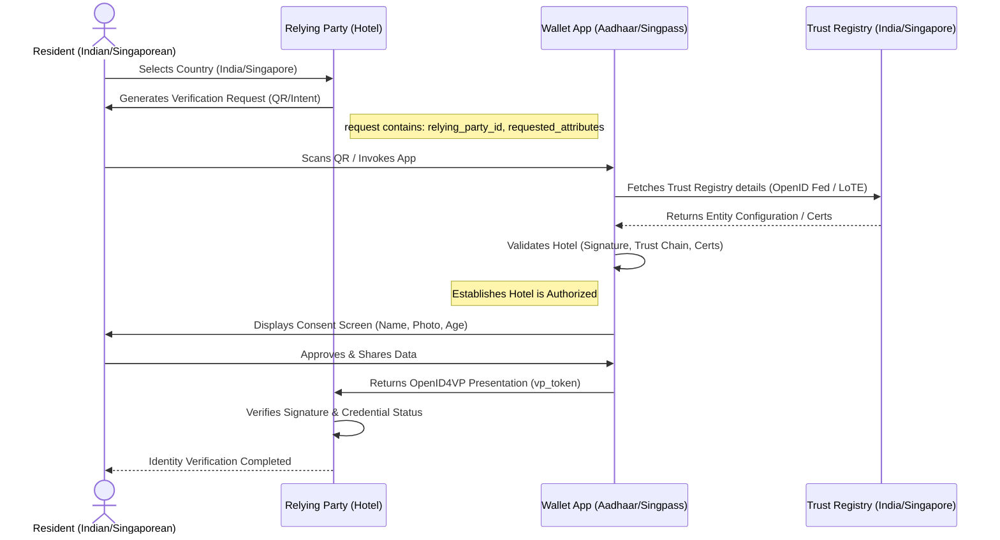

# Cross-Border Digital Identity Interoperability
**Singapore & India Joint Working Group (JWG)**

---

## Slide 1: User Journey – Checking into a Hotel in Singapore

**Actors Involved:**
*   **Indian Resident** (The User)
*   **Singapore Hotel** (The Relying Party - RP)
*   **Aadhaar App / Google Wallet** (The Wallet)
*   **India Trust Registry** & **Singapore Trust Registry**

### Step-by-Step User Flow

1. **Country Selection**
   *   **Hotel asks:** "Which country issued your digital identity?" (Options: India, Singapore, Others)
   *   **Resident selects:** India

2. **Verification Request Generation**
   *   The Hotel generates a verification request based on the channel:
       *   **Cross-device:** Generates a QR code.
       *   **Same-device:** Generates an App Link / Credential Manager invocation.
   *   *Request payload contains:*
       *   `country=India`
       *   `relying_party_id=sg-hotel-001`
       *   `requested_attributes`: [Name, Photo, Age Above 18]
       *   `callback_url=https://hotel.sg/callback`

3. **Wallet Invocation**
   *   Resident opens the Aadhaar App, Google Wallet, or any compliant wallet.
   *   Wallet scans the QR code or receives the intent.

---

## Slide 2: Behind the Scenes – Trust Establishment

This is where the Trust Registry works transparently in the background to ensure security and authorization.

### Option A – OpenID Federation
1. **Request Reception:** Wallet receives `relying_party_id = sg-hotel-001` and `country = India`.
2. **Entity Lookup:** Wallet calls the India Trust Registry:
   *   `GET https://trust.aadhaar.gov.in/api/entities/sg-hotel-001`
   *   *Response yields entity configuration endpoint:* `https://hotel.sg/.well-known/openid-federation`
3. **Configuration Retrieval:** Wallet retrieves the federation details from the Hotel's endpoint.
4. **Validation:** Wallet validates JWS Signatures, Trust Marks, Authority Hints, and the Trust Chain.
   *   *Conclusion:* Singapore Hotel is **Authorized** by India Trust Registry & allowed to receive Aadhaar data.
5. **Presentation Requirements:** Wallet fetches the requested claims (Name, Photo, Age Above 18) and proceeds to the user consent screen.

### Option B – Offline Trust Registry
1. **Periodic Sync:** Wallet periodically downloads the List of Trusted Entities (LoTE) and X.509 Certificates (`GET /api/lote`).
2. **Local Lookup:** QR contains `relying_party_id=sg-hotel-001`. Wallet searches the cached LoTE locally.
3. **Validation:** Wallet validates the Hotel's Certificate (Valid, Not Revoked, Allowed).
4. **Consent:** Wallet proceeds directly to the user consent screen (No active network call to the registry required during the transaction).

---

## Slide 3: Credential Exchange & Symmetric Model

### The Exchange Process
1. **Consent:** Wallet displays: *"Singapore Hotel requests: Name, Photograph, Age Above 18. Share?"* -> Resident approves.
2. **Presentation Creation:** Wallet creates an OpenID4VP Presentation (Formats: SD-JWT VC or mDoc).
3. **Data Transfer:** Wallet returns `vp_token` and `presentation_submission` to the Hotel's callback URL.
4. **Verification:** Hotel verifies the Presentation Signature, Trust Registry Status, Credential Status, and Requested Claims. **Identity verification is completed.**

### Reverse Flow (Singapore Citizen in India)
The architecture is **completely symmetric**. 
*   Resident selects `country = Singapore`.
*   Singpass (or Wallet) queries `trust.singpass.gov.sg` to retrieve trust information.
*   Wallet verifies the Indian Hotel (RP).
*   Resident presents Singapore Credentials.

---

## Architecture Diagram (Flow)

---

## Final Message for the Joint Working Group (JWG)

Cross-border interoperability is achieved securely and symmetrically through three common layers:

1. **Trust Layer:** Interoperable Trust Registries using OpenID Federation, LoTE, X.509, and Trust Marks.
2. **Exchange Layer:** Common protocols like OpenID4VP, OpenID4VCI, and W3C Digital Credentials API.
3. **Credential Layer:** Common verifiable credential formats such as SD-JWT VC, ISO/IEC 18013-5 mDoc, and W3C VC.

> [!TIP]
> **Narrative Strategy for the Deck:** 
> 1. Start with the relatable user experience (Slide 1).
> 2. Introduce the technical Trust Establishment (Slide 2). 
> 3. Conclude with Credential Exchange and the Symmetric Cross-Border Model (Slide 3).
