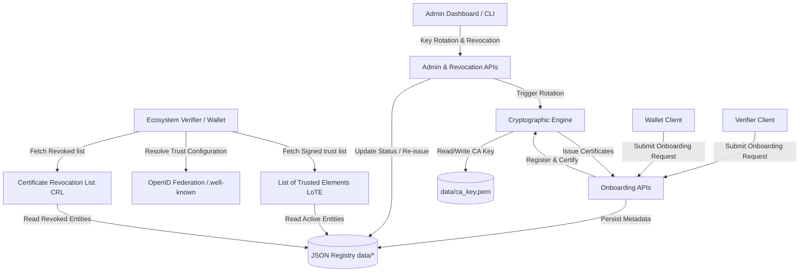
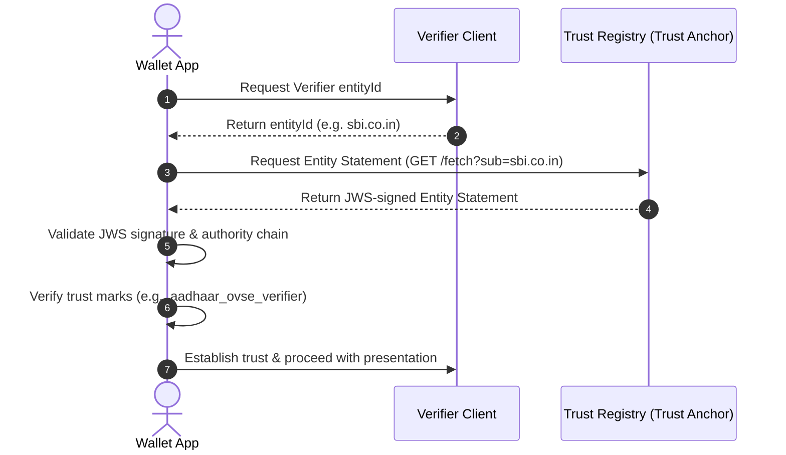
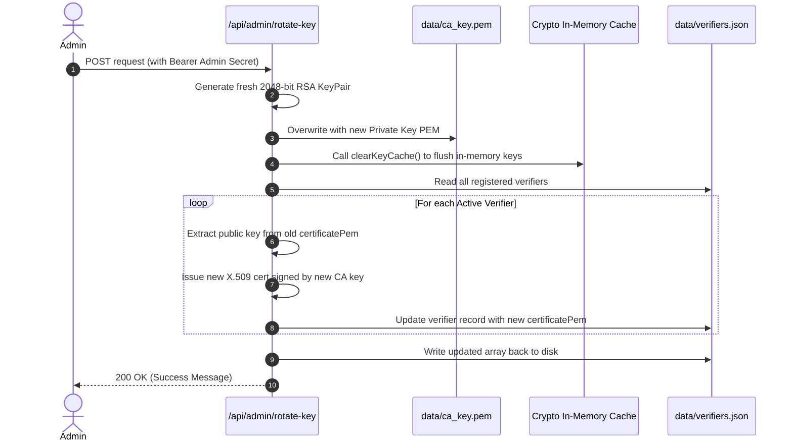

# Trust Registry - Architecture & API Specification

This document provides a comprehensive technical overview of the Trust Registry, an authoritative trust anchor infrastructure designed for the Aadhaar ecosystem. The Trust Registry acts as the single source of truth for authenticating, onboarding, querying, and revoking ecosystem participants (Verifiers and Wallets).

---

## 1. System Architecture

The Trust Registry is a Next.js 16 (App Router) project built with React 19, TypeScript, and Tailwind/Vanilla CSS. It serves as a lightweight, cryptographically secure PKI (Public Key Infrastructure) engine.

### 1.1 High-Level Component Architecture

The following diagram illustrates how the trust registry components interact:



### 1.2 Trust & Integration Profiles
The system supports three integration methods for participants to accommodate varying levels of cryptographic sophistication:

1. **Proprietary Profile**
   - Utilizes static, direct configuration mapping.
   - Trust is established through pre-registered public JWKs or simple metadata records in the registry.

2. **OpenID4VP (Offline) Profile**
   - Standardized deployment using X.509 certificates.
   - The Trust Registry issues short-lived/long-lived X.509 certificates to clients. The public certificate is compiled and hosted inside the centralized List of Trusted Elements (LoTE).
   - In offline mode, participating wallets periodically download the signed LoTE and use it for local trust evaluation. Relying parties are provisioned with short-lived X.509 certificates (2–4 weeks validity) with automated rotation.

3. **OpenID Federation Profile**
   - Utilizes the **OpenID Federation 1.0** standard.
   - During onboarding under the OpenID Federation profile, participants generate an **ECDSA** key pair (`ES256`, `ES384`, or `ES512`) and generate a PKCS#10 **Certificate Signing Request (`.csr`)**, which is cryptographically verified and signed by the Trust Registry to issue an X.509 certificate.
   - The Trust Registry acts as a Trust Anchor and exposes JWS-signed Entity Statements that allow participants to dynamically resolve and validate trust chains. Participants may optionally query lightweight status APIs for operational optimization; however, trust decisions shall be based on validation of signed federation metadata and trust chains.
   - Participants dynamically retrieve the entity's metadata and public key material through its OpenID Federation Entity Configuration endpoint (`/.well-known/openid-federation`). Trust is established by validating the JWS-signed Entity Statements and resolving the authority chain from the participating entity back to the UIDAI Trust Anchor.



---

## 2. Cryptographic Foundations & Management

### 2.1 The Trust Anchor (CA) Private Key
- **Algorithm**: RSA 2048-bit.
- **Storage**: Persisted securely in `data/ca_key.pem`.
- **Initialization**: Automatically generated on system startup if missing, or loaded from the `UIDAI_PRIVATE_KEY` environment variable.
- **Caching**: The PEM is parsed into a Node.js `KeyObject` and cached in-memory.

### 2.2 Certificate Generation & Issuance
Onboarding processes generate an X.509 certificate for the participant:
- The public key is supplied by the onboarding participant.
- The certificate is generated using `node-forge`.
- **Validity**: 1 year (from the exact time of onboarding).
- **Key Usages**: `digitalSignature`, `nonRepudiation`, `keyEncipherment`, `dataEncipherment` (CA constraint is set to `false`).
- **Signature**: Signed by the active Trust Anchor private key using `SHA-256`.

### 2.3 Dynamic Key Rotation Flow
The system supports zero-downtime, programmatic Trust Anchor key rotation.



---

## 3. Data Persistence Layer

The database consists of flat-file JSON datastores and PEM directories under the `/data` folder:
- **`data/ca_key.pem`**: The PEM-encoded trust anchor private key.
- **`data/verifiers.json`**:
  ```json
  [
    {
      "id": "1719134567890",
      "name": "State Hospital Network",
      "domain": "hospital.gov.in",
      "status": "Active",
      "integrationMethod": "OpenID4VP (Offline)",
      "logoUrl": "/logos/1719134567890-xyz.png",
      "contactInfo": "admin@hospital.gov.in",
      "certificatePem": "-----BEGIN CERTIFICATE-----\n...",
      "createdAt": "2026-06-23T10:00:00.000Z"
    }
  ]
  ```
- **`data/wallets.json`**:
  ```json
  [
    {
      "id": "1719134987654",
      "name": "E-Gov Wallet",
      "domain": "wallet.egov.gov.in",
      "status": "Active",
      "integrationMethod": "OpenID Federation",
      "logoUrl": null,
      "androidPackageName": "in.gov.egov.wallet",
      "callbackUrl": "https://wallet.egov.gov.in/api/callback",
      "contactInfo": "tech@egov.gov.in",
      "encryptionKey": "pem-encoded-encryption-public-key",
      "certificatePem": "-----BEGIN CERTIFICATE-----\n...",
      "createdAt": "2026-06-23T10:05:00.000Z"
    }
  ]
  ```

---

## 4. API Specification

### 4.1 Authentication
- Administrative endpoints (Revocation, Key Rotation) require authentication.
- Authentication type: **Bearer Token**.
- Secret Token: Specified by the `ADMIN_SECRET` environment variable (defaults to `trust-admin` for development).

---

### 4.2 Onboarding Endpoints

#### 4.2.1 Onboard Verifier
Registers a new verifier in the system and issues a signed X.509 certificate.

- **URL**: `/api/onboard`
- **Method**: `POST`
- **Content-Type**: `multipart/form-data`
- **Request Parameters**:
  | Name | Type | Required | Description |
  | :--- | :--- | :--- | :--- |
  | `verifierName` | String | Yes | Friendly name of the Verifier organization |
  | `domainName` | String | Yes | Verified domain of the Verifier |
  | `publicKey` | String | Yes | PEM-formatted RSA Public Key of the Verifier |
  | `integrationMethod` | String | Yes | `Proprietary`, `OpenID4VP (Offline)`, or `OpenID Federation` |
  | `logo` | File | No | Image file (png/jpg) representing the corporate logo |
  | `contactInfo` | String | No | Contact information or email address |

- **Response**:
  - **Status**: `200 OK`
  - **Headers**:
    - `Content-Type: application/zip`
    - `Content-Disposition: attachment; filename="verifier_certificate.zip"`
  - **Body**: A ZIP archive containing `certificate.pem` (the issued X.509 certificate signed by the Trust Anchor).

- **Error Responses**:
  - **Status**: `400 Bad Request` if missing required parameters.
  - **Status**: `500 Internal Server Error` if certificate creation fails.

---

#### 4.2.2 Onboard Wallet
Registers a new wallet in the system and issues a signed X.509 certificate.

- **URL**: `/api/wallets/onboard`
- **Method**: `POST`
- **Content-Type**: `multipart/form-data`
- **Request Parameters**:
  | Name | Type | Required | Description |
  | :--- | :--- | :--- | :--- |
  | `walletName` | String | Yes | Friendly name of the Wallet application |
  | `domainName` | String | Yes | Domain name hosted by the wallet issuer |
  | `publicKey` | String | Yes | PEM-formatted RSA Public Key of the Wallet |
  | `integrationMethod` | String | Yes | `Proprietary`, `OpenID4VP (Offline)`, or `OpenID Federation` |
  | `logo` | File | No | Image file representing the wallet logo |
  | `androidPackageName`| String | No | Android application package name (e.g. `com.wallet.app`) |
  | `callbackUrl` | String | No | Intent redirection callback URL |
  | `contactInfo` | String | No | Contact details for security or operations |
  | `encryptionKey` | String | No | Public key used for response encryption |

- **Response**:
  - **Status**: `200 OK`
  - **Headers**:
    - `Content-Type: application/zip`
    - `Content-Disposition: attachment; filename="wallet_certificate.zip"`
  - **Body**: A ZIP archive containing `certificate.pem` (the issued X.509 certificate signed by the Trust Anchor).

---

### 4.3 Query & Discovery Endpoints

#### 4.3.1 Get All Registered Verifiers
Retrieves the raw list of all registered verifiers.

- **URL**: `/api/verifiers`
- **Method**: `GET`
- **Response**:
  - **Status**: `200 OK`
  - **Headers**: `Content-Type: application/json`
  - **Body**: Array of verifier metadata objects.
  - **Sample Payload**:
    ```json
    [
      {
        "id": "1719134567890",
        "name": "State Hospital Network",
        "domain": "hospital.gov.in",
        "status": "Active",
        "integrationMethod": "OpenID4VP (Offline)",
        "logoUrl": "/logos/1719134567890-xyz.png",
        "contactInfo": "admin@hospital.gov.in",
        "certificatePem": "-----BEGIN CERTIFICATE-----\n...",
        "createdAt": "2026-06-23T10:00:00.000Z"
      }
    ]
    ```

---

#### 4.3.2 Get All Registered Wallets
Retrieves the raw list of all registered wallets.

- **URL**: `/api/wallets`
- **Method**: `GET`
- **Response**:
  - **Status**: `200 OK`
  - **Headers**: `Content-Type: application/json`
  - **Body**: Array of wallet metadata objects.

---

### 4.4 Trust Infrastructure & Protocol Endpoints

#### 4.4.1 List of Trusted Elements (LoTE)
Returns the JWS-signed trust list complying with the ETSI TS 119 612 structure.

- **URL**: `/api/lote`
- **Method**: `GET`
- **Query Parameters**:
  - `type` (String, Optional): The participant type to fetch. Must be `verifier` or `wallet`. Defaults to `verifier`.
- **Response**:
  - **Status**: `200 OK`
  - **Headers**: `Content-Type: application/json`
  - **Body**:
    ```json
    {
      "trust_list_jwt": "eyJhbGciOiJSUzI1NiIsImtpZCI6InVpZGFpLXRydXN0LWFuY2hvci1rZXktMSIsInR5cCI6IkpXUyJ9.ey...",
      "trust_anchor_key": {
        "kty": "RSA",
        "n": "v5g7k...",
        "e": "AQAB",
        "kid": "uidai-trust-anchor-key-1",
        "alg": "RS256",
        "use": "sig"
      }
    }
    ```
- **JWT Payload Structure (Decoded `trust_list_jwt`)**:
  ```json
  {
    "iss": "https://trust.aadhaar.gov.in",
    "iat": 1719159000,
    "list_type": "https://trust.aadhaar.gov.in/Trst/Type/aadhaar",
    "sequence_number": 1,
    "issue_date": "2026-06-23T10:50:00.000Z",
    "next_update": "2026-06-24T10:50:00.000Z",
    "trust_service_providers": [
      {
        "tsp_name": "State Hospital Network",
        "tsp_information": {
          "id": "1719134567890",
          "domain": "hospital.gov.in"
        },
        "services": [
          {
            "service_name": "Aadhaar Verifier (OpenID4VP (Offline))",
            "service_type": "https://trust.aadhaar.gov.in/Trst/Svctype/IdV",
            "status": "https://trust.aadhaar.gov.in/Trst/Svcstatus/granted",
            "service_digital_identity": {
              "x509_certificate": "-----BEGIN CERTIFICATE-----\n..."
            }
          }
        ]
      }
    ]
  }
  ```

---

#### 4.4.2 Certificate Revocation List (CRL)
Returns a JWS-signed representation of all revoked participants.

- **URL**: `/api/crl`
- **Method**: `GET`
- **Query Parameters**:
  - `type` (String, Optional): The participant type to fetch. Must be `verifier` or `wallet`. Defaults to `verifier`.
- **Response**:
  - **Status**: `200 OK`
  - **Headers**: `Content-Type: application/json`
  - **Body**:
    ```json
    {
      "crl_jwt": "eyJhbGciOiJSUzI1NiIsImtpZCI6InVpZGFpLXRydXN0LWFuY2hvci1rZXktMSIsInR5cCI6IkpXUyJ9.ey...",
      "trust_anchor_key": {
        "kty": "RSA",
        "n": "v5g7k...",
        "e": "AQAB",
        "kid": "uidai-trust-anchor-key-1",
        "alg": "RS256",
        "use": "sig"
      }
    }
    ```
- **JWT Payload Structure (Decoded `crl_jwt`)**:
  ```json
  {
    "iss": "https://trust.aadhaar.gov.in",
    "iat": 1719159000,
    "list_type": "https://trust.aadhaar.gov.in/Trst/Type/crl",
    "lastUpdated": "2026-06-23T10:50:00.000Z",
    "revoked": [
      {
        "id": "1719134000000",
        "name": "Revoked Partner Inc",
        "domain": "revokedpartner.com",
        "revokedAt": "2026-06-23T10:45:00.000Z",
        "certificatePem": "-----BEGIN CERTIFICATE-----\n..."
      }
    ]
  }
  ```

---

#### 4.4.3 OpenID Federation Entity Configuration
Serves the self-signed Entity Configuration of the Trust Anchor in accordance with OpenID Federation 1.0. The Entity Configuration contains the Trust Anchor's metadata, public signing keys, federation capabilities, and trust mark information required for dynamic trust resolution.

- **URL**: `/.well-known/openid-federation`
- **Method**: `GET`
- **Response**:
  - **Status**: `200 OK`
  - **Headers**: `Content-Type: application/entity-statement+jwt`
  - **Body**: A signed JWT string containing the entity statement.
- **JWT Payload Structure (Decoded)**:
  ```json
  {
    "iss": "https://trust.aadhaar.gov.in",
    "sub": "https://trust.aadhaar.gov.in",
    "iat": 1719159000,
    "jwks": {
      "keys": [
        {
          "kty": "RSA",
          "n": "v5g7k...",
          "e": "AQAB",
          "kid": "uidai-trust-anchor-key-1",
          "alg": "RS256",
          "use": "sig"
        }
      ]
    },
    "metadata": {
      "federation_entity": {
        "organization_name": "Aadhaar Trust Registry Anchor",
        "homepage_uri": "https://trust.aadhaar.gov.in",
        "policy_uri": "https://trust.aadhaar.gov.in/policy",
        "contacts": ["admin@uidai.gov.in"]
      },
      "trust_mark_issuer": {}
    },
    "authority_hints": []
  }
  ```

---

#### 4.4.4 OpenID Federation Fetch (Subordinate Statements)
Allows dynamic trust resolution by serving subordinate entity configuration statements.

- **URL**: `/fetch`
- **Method**: `GET`
- **Query Parameters**:
  | Name | Type | Required | Description |
  | :--- | :--- | :--- | :--- |
  | `sub` | String | Yes | Identifier of subordinate entity |
  | `iss` | String | No | Issuer whose entity statement is requested |
- **Response**:
  - **Status**: `200 OK`
  - **Headers**: `Content-Type: application/entity-statement+jwt`
  - **Body**: A signed JWT string containing the subordinate entity statement.
- **JWT Payload Structure (Decoded)**:
  ```json
  {
    "iss": "https://trust.aadhaar.gov.in",
    "sub": "https://sbi.co.in",
    "iat": 1719159000,
    "exp": 1719162600,
    "jwks": {
      "keys": [
        {
          "kty": "RSA",
          "e": "AQAB",
          "n": "mock_sbi_modulus...",
          "alg": "RS256"
        }
      ]
    },
    "metadata_policy": {
      "openid_relying_party": {
        "client_name": { "value": "State Bank of India" },
        "logo_uri": {},
        "redirect_uris": { "value": "https://sbi.co.in/callback" },
        "contacts": { "value": "abee@sbi.co.in" }
      }
    },
    "trust_marks": [
      {
        "id": "aadhaar_ovse_verifier",
        "trust_mark": "signed_trust_mark_jwt...",
        "type": "verifier"
      }
    ],
    "authority_hints": [
      "https://trust.aadhaar.gov.in"
    ]
  }
  ```
- **Error Responses**:
  - **Status**: `400 Bad Request` if `sub` parameter is missing.
  - **Status**: `404 Not Found` if subordinate is not recognized (currently mock resolves only `https://sbi.co.in`).

---

#### 4.4.5 Verify Entity Status
Allows dynamic operational status query of an entity by its identifier.

- **URL**: `/api/entities/{entityId}`
- **Method**: `GET`
- **Response**:
  - **Status**: `200 OK`
  - **Headers**: `Content-Type: application/json`
  - **Body**:
    ```json
    {
      "entityId": "sbi.co.in",
      "status": "active",
      "entityType": "verifier",
      "integrationMethod": "OpenID Federation",
      "entityConfiguration": "https://sbi.co.in/.well-known/openid-federation"
    }
    ```

---

#### 4.4.6 Hybrid Federation Verification (Wallet Authorization)
Allows a Wallet to request Verifier authorization using a signed Client Assertion JWT.

- **URL**: `/api/federation/verify`
- **Method**: `POST`
- **Headers**: `Content-Type: application/json`
- **Request Body**:
  ```json
  {
    "entityId": "sbi.co.in",
    "client_assertion": "eyJhbGciOiJFUzI1NiIsInR5cCI6IkpXVCJ9..."
  }
  ```
- **Response**:
  - **Status**: `200 OK`
  - **Headers**: `Content-Type: application/json`
  - **Body**:
    ```json
    {
      "status": "authorized",
      "wallet_authenticated_as": "wallet-id-or-iss",
      "entity_statement": "eyJhbGciOiJFUzI1NiIsInR5cCI6ImVudGl0eS1zdGF0ZW1lbnQrand0In0..."
    }
    ```
- **Error Responses**:
  - **Status**: `401 Unauthorized` if Wallet's `client_assertion` is invalid or unsigned.
  - **Status**: `404 Not Found` if requested Verifier `entityId` does not exist or is revoked.

---

### 4.5 Administrative & Control Endpoints

#### 4.5.1 Revoke Verifier
Revokes a verifier's status and updates the active registry database.

- **URL**: `/api/verifiers/revoke`
- **Method**: `POST`
- **Headers**:
  - `Content-Type: application/json`
  - `Authorization: Bearer <ADMIN_SECRET>`
- **Request Body**:
  ```json
  {
    "verifierId": "1719134567890"
  }
  ```
- **Response**:
  - **Status**: `200 OK`
  - **Body**:
    ```json
    {
      "success": true,
      "message": "Verifier successfully revoked"
    }
    ```
- **Error Responses**:
  - **Status**: `401 Unauthorized` if Authorization header is missing.
  - **Status**: `403 Forbidden` if Bearer token is incorrect.
  - **Status**: `404 Not Found` if the verifier is not found in the database.
  - **Status**: `400 Bad Request` if the verifier is already revoked.

---

#### 4.5.2 Revoke Wallet
Revokes a wallet's status and updates the active registry database.

- **URL**: `/api/wallets/revoke`
- **Method**: `POST`
- **Headers**:
  - `Content-Type: application/json`
  - `Authorization: Bearer <ADMIN_SECRET>`
- **Request Body**:
  ```json
  {
    "walletId": "1719134987654"
  }
  ```
- **Response**:
  - **Status**: `200 OK`
  - **Body**:
    ```json
    {
      "success": true,
      "message": "Wallet successfully revoked"
    }
    ```

---

#### 4.5.3 Rotate Trust Anchor Private Key
Triggers key rotation on the Trust Anchor. Overwrites the root private key, invalidates cryptographic caches, and automatically updates and re-signs all X.509 certificates for all active verifiers.

- **URL**: `/api/admin/rotate-key`
- **Method**: `POST`
- **Headers**:
  - `Authorization: Bearer <ADMIN_SECRET>`
- **Response**:
  - **Status**: `200 OK`
  - **Body**:
    ```json
    {
      "success": true,
      "message": "CA Key Rotated and Certificates Regenerated"
    }
    ```
- **Error Responses**:
  - **Status**: `401 Unauthorized` if Bearer token is incorrect or missing.
  - **Status**: `500 Internal Server Error` if dynamic generation or re-issuance logic fails.
